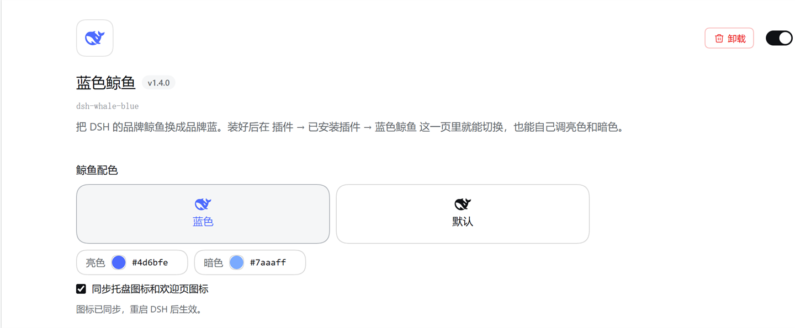
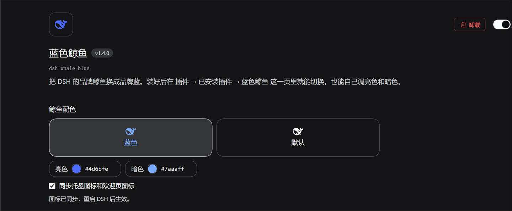

# dsh-whale-blue 🐋

Repaint the **DeepSeek Harness** whale in **DeepSeek blue** — in the chat UI, the system tray, the window / about icon, and the first-run welcome window. Fully reversible.

After installing, the bundle's own page — **插件 → 已安装插件 → 蓝色鲸鱼** — gains a "鲸鱼配色" form: switch blue on or off with one click, or pick your own light and dark colors. Nothing is added to the Settings pages.

> Unofficial. The whale artwork belongs to DeepSeek; this project only changes its color.

Two ways to install: paste this repository's URL into DSH's **Plugins** page (recommended — no Node.js, no clone), or clone it and run `install.cmd`. See [Install](#install).


[中文说明](README.md)

## What changes

| Where | How | Result |
| --- | --- | --- |
| Sidebar brand mark (and the collapsed rail) | Cordis plugin, one injected stylesheet | ✅ |
| Empty-conversation hero whale | same SVG, same stylesheet | ✅ |
| System tray icon | `install` recolors `resources/tray.ico` | ✅ |
| Window / about / quit-dialog icon | `install` recolors `resources/icon.png` | ✅ |
| First-run / sign-in welcome mark | `install` rewrites `welcome-brand.svg` inside `app.asar` in place | ✅ (whale only, text keeps its color) |
| Settings item on the bundle page | the package's browser half `client.js`, registered into the `plugins.bundle.config` slot | — |


## Why two halves

The chat UI runs inside the Cordis plugin host, so a plugin can inject a `<style>` row into every index response (`webserver/index-inject`). The tray icon, window icon and welcome window live in the Electron shell instead — plain files (`resources/tray.ico`, `resources/icon.png`) and a file inside `app.asar` — which no plugin can reach. Those are patched by `bin/cli.mjs`, with backups and a byte-exact `restore`.

## Install

Requires Windows DSH desktop (verified on `0.2.1-rc.2`). **Installing from the Plugins page needs no Node.js and no clone.**

### Option 1: the Plugins page (recommended)

1. Open DSH and pick **插件** in the sidebar.
2. Click **添加插件**, paste the repository URL and press Enter:

   ```
   https://github.com/liushenme1999/dsh-whale-blue
   ```

3. **安装**, then click **立即启用** on the result screen.

   > Closing the dialog also installs it, but the bundle stays **off**. Go to **已安装插件**, find 蓝色鲸鱼 and switch it on (the same switch is on its detail page).
4. Restart DSH. `Ctrl+R` only reloads the page: the plugin row is composed when the host starts, so the first time needs a full restart.
5. Open **插件 → 已安装插件** and click the 蓝色鲸鱼 card: the 鲸鱼配色 form is on that page.

That installs a **bundle**: `dsh.bundle.patch` in `package.json` points at `cordis.patch.yml`, which inserts the plugin row. Your choices are not written back into the package — they go into the profile's own `cordis.patch.yml` as an id-targeted override, so **upgrading or reinstalling the bundle keeps your colors**.

To confirm it took: `dsh.profile.bundles` in `~/.dsh/profiles/desktop/package.json` should list `dsh-whale-blue`. If only `dependencies` has it, the bundle is installed but not enabled.

This installs from GitHub, not from npm, so no registry mirror is involved. Behind a network that cannot reach GitHub the dialog reports 无法访问 GitHub / 连接 GitHub 超时; use option 2 there.

### Option 2: the command line (local clone)

For machines without the Plugins page (a `dsh web` build, a custom profile) or when you also want the tray icon:

```powershell
git clone https://github.com/liushenme1999/dsh-whale-blue.git
cd dsh-whale-blue
```

1. Quit DeepSeek Harness completely (tray icon → Quit).
2. Double-click `install.cmd`, or run `node bin/cli.mjs install`.
3. Start DeepSeek Harness.

This copies the package to `<profile>/local/whale-blue/` and inserts the row itself. After a restart the 鲸鱼配色 item sits under **Settings → 通用设置 → 外观**: a command-line copy never shows up on the Plugins page, which lists profile bundles only. **Pick one option per profile**: two rows with the same id mount the plugin twice. If you already installed from the CLI and switch to the Plugins page, run `restore.cmd` first — and if you forget, the plugin rewrites the leftover insert row on its next start (one extra log line on that boot).

Web GUI only (no file patching, no admin, no shell restart) — which is also the default for a Plugins-page install (`desktop: false`), where tray syncing is one click on the bundle page:

```powershell
node bin/cli.mjs install --no-desktop
```

## The form on the bundle page

Open **插件 → 已安装插件 → 蓝色鲸鱼**: the form sits between the package name and the row list — the same place the official bundles put their configuration — and the Settings pages stay untouched:

| Light | Dark |
| --- | --- |
|  |  |

- **蓝色 / 默认** switches the whale instantly; no reload.
- The two color fields take any `#rgb` / `#rrggbb` and apply immediately.
- **同步托盘图标和欢迎页图标** rewrites the icons and `app.asar` right away; the tray and welcome window read them at startup, so a DSH restart is what makes them visible.
- **默认** also un-syncs the tray and welcome mark, so one click puts everything back.

Every choice is written back into the managed block of the profile's `cordis.patch.yml`, so it survives restarts. To drop the form: switch the bundle off on the Plugins page (that stops the recoloring too), or uninstall the plugin.

> A command-line install (`local/whale-blue`) never shows up on the Plugins page — that page lists profile bundles, while the CLI only inserts a file-path row. It puts the **same controls** under **Settings → 通用设置 → 外观** instead, with identical behavior and the same state file.

## Replacing system icons: Windows shortcut / taskbar, macOS app icon

The repo ships the whale as a transparent-background icon set (brand blue `#4d6bfe`, the same artwork as in the UI):


| File | For | Contents |
| --- | --- | --- |
| `docs/whale-blue.ico` | Windows | 16 / 20 / 24 / 32 / 40 / 48 / 64 / 128 / 256, 9 frames |
| `docs/whale-blue.icns` | macOS | 16 – 1024, including @2x |
| `docs/whale-blue-1024.png` | macOS Get Info paste, or anywhere you need a PNG | 1024², transparent |

These replace **system icons** (shortcut, taskbar, Dock). The plugin's job is the whale inside the app; the two are independent, and both are reversible.

Copy the icon somewhere permanent first (`%USERPROFILE%\Pictures\Icons\` on Windows, `~/Pictures/Icons/` on macOS) — if the file is moved or deleted the system falls back to a blank icon.

### Windows: desktop shortcut + taskbar

**Desktop shortcut**

1. No shortcut yet? Right-click `DeepSeek Harness.exe` → **发送到 → 桌面快捷方式**;
2. Right-click it → **属性** → **快捷方式** tab → **更改图标…**;
3. **浏览** → pick `whale-blue.ico` → **打开** → **确定** → **确定**.

**Taskbar**

The taskbar pins a separate copy of the shortcut (under `%APPDATA%\Microsoft\Internet Explorer\Quick Launch\User Pinned\TaskBar`), so the desktop one does not carry over:

1. Right-click the old icon on the taskbar → **取消固定**;
2. Right-click the desktop shortcut you just re-iconed → **固定到任务栏** (Windows 11 may hide it behind **显示更多选项**).

> Nothing changed, or it changed back? **Unpin and re-pin** the taskbar entry — that is the step that matters.
>
> A pinned shortcut draws its own icon, but a *running* window can still carry the icon embedded in the exe; rewriting that means patching the exe resources (kills the signature and updates), which this project does not do.

### macOS: app icon

Both routes use the Finder's **显示简介** panel — no extra software, fully reversible.

**Option 1: copy and paste**

1. Open `whale-blue-1024.png` in Preview, `Command + A`, `Command + C`;
2. In Finder → Applications, right-click DeepSeek Harness → **显示简介** (or select it and press `Command + I`);
3. Click the **small icon at the top-left** of the panel; it gets a blue/highlighted border when selected;
4. `Command + V` — the icon changes immediately.

> If the paste does nothing you clicked the large preview on the right instead of the small icon in the top-left corner.

**Option 2: drag the file in**

1. Open **显示简介** the same way;
2. Drag `whale-blue.icns` (or any 512 / 1024 PNG) onto the small icon; release when a green "+" appears.

**Dock still shows the old icon?**
Remove the app from the Dock — right-click → **选项 → 从程序坞中移除**, or drag it out — then drag it back from Applications (or just launch it again) and the new icon sticks.

**To revert**: open **显示简介**, click the small icon, press `Delete` (`Backspace`).

> If the app lives in `/Applications` and is not owned by you, pasting or dragging may ask for an administrator password. That is normal.

## Commands

```
dsh-whale-blue install|restore|status [options]

--app-dir <path>   install directory (auto-detected by default)
--dsh-home <path>  DSH home (default $DSH_HOME or ~/.dsh)
--profile <name>   profile to configure (default desktop)
--light <color>    light-palette whale color (default #4d6bfe)
--dark <color>     dark-palette whale color (default #7aaaff)
--no-plugin        skip the web GUI plugin
--no-desktop       skip tray icon, window icon and welcome mark
--dry-run          report only
```

`restore.cmd` / `node bin/cli.mjs restore` puts the original bytes back (verify with `Get-FileHash` if you like), removes the plugin row and deletes the installed plugin copy.

## How it works

- **Web GUI**: `svg[viewBox="0 0 23.16 17.04"] path { fill: … }` beats the SVG's `fill="currentColor"` presentation attribute, so only the whale changes; theme tokens (which also color all text) are untouched. Dark mode is `body[data-ds-dark-theme]`, not `prefers-color-scheme`.
- **Icons**: a dependency-free PNG/ICO codec remaps dark pixels to the brand color, fades mid-tones toward white to keep the original antialiasing, and leaves light pixels alone.
- **Welcome mark**: only the whale's `fill` attribute is rewritten, to an *equal-length* value (`rgb(77,107,254)` padded with spaces). The archive's directory and every offset stay untouched, and `replaceAsarFile()` refuses any replacement that changes the byte length.
- **The form**: not a bundled frontend and not an injected script — the package ships a browser half (`client.js`) declared by `dsh.client` in `package.json`, which the host serves to the page like any other module. It registers one React component into the Plugins page's `plugins.bundle.config` slot, keyed by the package name, so it renders between the description and the row list; the page mounts it only while the bundle is on and its card is open. State lives behind the plugin's `/dsh-whale-blue/state` route; POSTs must carry an `x-dsh-whale-blue` header, so a cross-origin page cannot drive it (the preflight is never answered). A color change also re-injects the stylesheet in the page, because the one the host injected into the index response was computed at page load. A command-line install has no card to hang the form on, so it falls back to the older implementation injected into Settings (`lib/ui.js`, plain DOM, no build step), selected by `INSTALL_MODE === 'local'`; both shapes share the same state route and the same managed block.
- **Preview icons**: the two cubes draw the same whale SVG, so the recoloring rule would paint the "default" preview blue too. Those SVGs are marked `data-dsh-wb-icon` and the rule is `svg[viewBox="…"]:not([data-dsh-wb-icon]) path`.
- **Electron gotcha**: inside the desktop shell, `node:fs` is wrapped by the asar layer, and `open('app.asar', 'r+')` is read as "open an entry of that archive" → `ENOENT,  not found in …app.asar`. `lib/asar.mjs` therefore switches to `original-fs` when it detects `process.versions.electron`, so a running DSH can patch the welcome mark too.

Backups live in `<install>\resources\.dsh-whale-blue\`. After a DSH update the tool notices the assets no longer match its own output and retakes the backups.

### How it becomes an installable bundle

DSH's definition is narrow: **a package whose `package.json` declares `dsh.bundle.patch` is a bundle**. The Plugins page only runs `pnpm add` in the profile and appends the package name to `dsh.profile.bundles`; everything else is layered at startup:

```
each bundle's cordis.patch.yml  →  the profile's cordis.patch.yml  →  --patch overlays
```

So the package ships:

| File | Role |
| --- | --- |
| `cordis.patch.yml` | the bundle layer: inserts the `whale-blue` row; its `config` is just the default |
| `dsh.bundle.patch` in `package.json` | declares the bundle and the patch file |
| `dsh.client` in `package.json` + `client.js` | the browser half: the host serves `client.js` to the page, and the Plugins page renders its form in the bundle's config slot |
| `exports` in `package.json` | lets `locale/*.json`, `icon`, `cordis.patch.yml` and `./client` be resolved as subpaths (an `exports` map hides everything it does not list) |
| `locale/{zh,en}.json` | card title and description (`meta.title` / `meta.description`, readable without loading code) |
| `icon.svg` | card icon: SVG / PNG / JPEG / WebP, ≤256 KiB, inside the package |

Two loader semantics shape the managed block:

1. A non-insert patch **replaces the whole `config`** (no deep merge), so every write carries the complete set of fields.
2. A non-insert patch matches by `id`, and optionally by `name` — a mismatch skips the patch entirely. The bundle inserts the row as `whale-blue`, so the block writes only the id: the CLI's row is named by a `file://` URL, and naming it here would fail the check.

One trap is bundle-specific: the bundle already inserts `whale-blue`, so a second `insert` in the profile layer would put two rows with one id in the tree and mount the plugin twice. The plugin therefore picks the shape from where it is installed (`install: 'bundle' | 'local'`, i.e. whether its path contains `node_modules`) and rewrites a leftover insert row into an override at startup.

Tray syncing self-checks at startup for the same reason: a bundle install has no CLI to run, so if the config asks for the icons and the files are unpatched (say a DSH update replaced `resources/`), boot applies the patch again.

## Notes

- Still black after installing? The plugin row is read at startup — restart DSH (a browser tab only needs a refresh).
- No "鲸鱼配色" form? It lives on the bundle page: Plugins → **已安装插件** → 蓝色鲸鱼. Installs up to `1.3.0` had it under Settings → 通用设置 → 外观 instead.
- Installed from the Plugins page but there is no "鲸鱼配色" form? First check that the bundle is **on**: Plugins → **已安装插件** → the 蓝色鲸鱼 switch. Closing the install dialog leaves it installed but **off**, its patch layer never applies, and the row is never inserted (`dependencies` lists it, `dsh.profile.bundles` does not). Switch it on, then restart DSH.
- No card in the list at all? `pnpm add` failed — reinstall and read **查看安装详情**.
- The dialog says 无法访问 GitHub / 连接 GitHub 超时? It probes the repository with `git ls-remote` before installing. Change network, or use the command line (clone and `install.cmd`).
- Synced the tray but the welcome page is unchanged? Both are read at startup; restart DSH. If `app.asar` was busy the form says so: a bundle install retries on the next start, a CLI install needs `restore.cmd` + `install.cmd`.
- A change that comes back after a restart means it could not be written to `cordis.patch.yml`: the form shows that in red, and `node bin/cli.mjs status` prints what the file records.
- A replaced system icon that did not take? On Windows the taskbar entry has to be **unpinned and re-pinned** (it points at a separate shortcut copy); on macOS remove the app from the Dock and add it back. Full steps are in the section above.
- Installed from the CLI first and then from the Plugins page? The plugin rewrites the leftover insert row into an override at startup and keeps your colors; running `restore.cmd` first is cleaner. The other order is refused by the CLI, which points at the Plugins page.
- `dsh web` / browser use: the plugin half works everywhere (`--no-desktop`, or the Plugins page).
- The asar integrity fuse is disabled in the desktop build, and the file length never changes.

## Development

```powershell
node --test test/lib.test.mjs
```

## License

MIT
