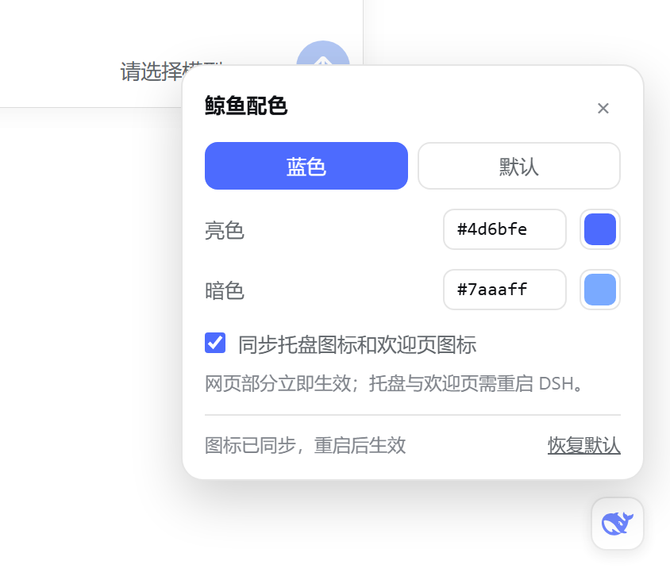
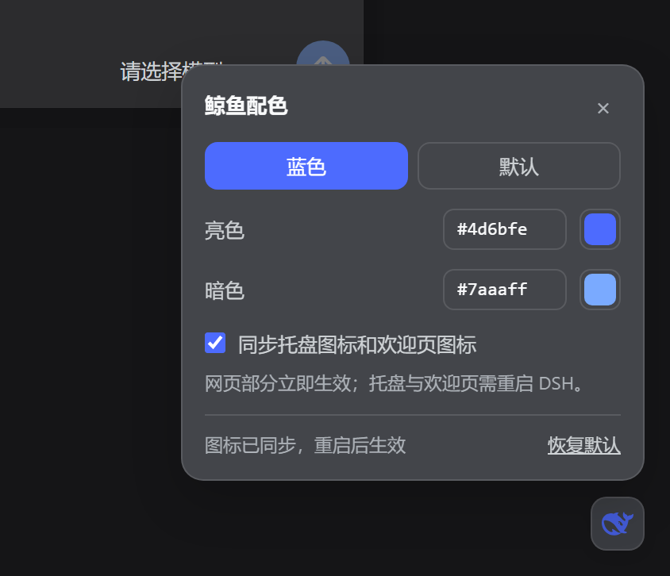

# dsh-whale-blue 🐋

Repaint the **DeepSeek Harness** whale in **DeepSeek blue** — in the chat UI, the system tray, the window / about icon, and the first-run welcome window. Fully reversible.

After installing, a small whale button sits in the bottom-right corner of the UI. Click it to switch blue on or off with one click, or to pick your own light and dark colors.

> Unofficial. The whale artwork belongs to DeepSeek; this project only changes its color.


[中文说明](README.md)

## What changes

| Where | How | Result |
| --- | --- | --- |
| Sidebar brand mark (and the collapsed rail) | Cordis plugin, one injected stylesheet | ✅ |
| Empty-conversation hero whale | same SVG, same stylesheet | ✅ |
| System tray icon | `install` recolors `resources/tray.ico` | ✅ |
| Window / about / quit-dialog icon | `install` recolors `resources/icon.png` | ✅ |
| First-run / sign-in welcome mark | `install` rewrites `welcome-brand.svg` inside `app.asar` in place | ✅ (whale only, text keeps its color) |
| In-page palette panel | injected `<script>` + a local `/dsh-whale-blue/state` route | — |
| Windows taskbar button icon | comes from the exe resources | ❌ |


## Why two halves

The chat UI runs inside the Cordis plugin host, so a plugin can inject a `<style>` row into every index response (`webserver/index-inject`). The tray icon, window icon and welcome window live in the Electron shell instead — plain files (`resources/tray.ico`, `resources/icon.png`) and a file inside `app.asar` — which no plugin can reach. Those are patched by `bin/cli.mjs`, with backups and a byte-exact `restore`.

## Install

Requires Node.js 20+ (or use `install.cmd`, which also finds the node bundled with DSH).

```powershell
git clone https://github.com/<you>/dsh-whale-blue.git
cd dsh-whale-blue
```

1. Quit DeepSeek Harness completely (tray icon → Quit).
2. Double-click `install.cmd`, or run `node bin/cli.mjs install`.
3. Start DeepSeek Harness.

Web GUI only (no file patching, no admin, no restart of any shell):

```powershell
node bin/cli.mjs install --no-desktop
```

## The panel

Restart DSH and a whale button appears in the bottom-right corner. It opens this:

| Light | Dark |
| --- | --- |
|  |  |

- **Blue / Default** switches the whale instantly; no reload.
- The two color fields take any `#rgb` / `#rrggbb` and apply immediately.
- **Sync tray and welcome icon** rewrites the icons and `app.asar` right away; the tray and welcome window read them at startup, so a DSH restart is what makes them visible.
- **Reset** returns to blue and drops the sync in one go.

Every choice is written back into the managed block of the profile's `cordis.patch.yml`, so it survives restarts. `install --no-ui` (or `ui: false` in that block) installs the plugin without the panel.

## Commands

```
dsh-whale-blue install|restore|status [options]

--app-dir <path>   install directory (auto-detected by default)
--dsh-home <path>  DSH home (default $DSH_HOME or ~/.dsh)
--profile <name>   profile to configure (default desktop)
--light <color>    light-palette whale color (default #4d6bfe)
--dark <color>     dark-palette whale color (default #7aaaff)
--no-plugin        skip the web GUI plugin
--no-ui            install the plugin without the in-page panel
--no-desktop       skip tray icon, window icon and welcome mark
--dry-run          report only
```

`restore.cmd` / `node bin/cli.mjs restore` puts the original bytes back (verify with `Get-FileHash` if you like), removes the plugin row and deletes the installed plugin copy.

## How it works

- **Web GUI**: `svg[viewBox="0 0 23.16 17.04"] path { fill: … }` beats the SVG's `fill="currentColor"` presentation attribute, so only the whale changes; theme tokens (which also color all text) are untouched. Dark mode is `body[data-ds-dark-theme]`, not `prefers-color-scheme`.
- **Icons**: a dependency-free PNG/ICO codec remaps dark pixels to the brand color, fades mid-tones toward white to keep the original antialiasing, and leaves light pixels alone.
- **Welcome mark**: only the whale's `fill` attribute is rewritten, to an *equal-length* value (`rgb(77,107,254)` padded with spaces). The archive's directory and every offset stay untouched, and `replaceAsarFile()` refuses any replacement that changes the byte length.
- **Panel**: not a bundled frontend — a plain `<script>` row injected next to the stylesheet. It renders into a shadow root (so its styles stay put) while the `--dsw-alias-*` design tokens pass through, which is why it matches the light and dark palettes for free. State lives behind the plugin's `/dsh-whale-blue/state` route; POSTs must carry an `x-dsh-whale-blue` header, so a cross-origin page cannot drive it (the preflight is never answered).
- **Electron gotcha**: inside the desktop shell, `node:fs` is wrapped by the asar layer, and `open('app.asar', 'r+')` is read as "open an entry of that archive" → `ENOENT,  not found in …app.asar`. `lib/asar.mjs` therefore switches to `original-fs` when it detects `process.versions.electron`, so the panel can patch the welcome mark even while DSH is running.

Backups live in `<install>\resources\.dsh-whale-blue\`. After a DSH update the tool notices the assets no longer match its own output and retakes the backups.

## Notes

- Still black after installing? The plugin row is read at startup — restart DSH (a browser tab only needs a refresh).
- No whale button? Same reason, plus check that the row does not say `ui: false`.
- Synced the tray but the welcome page is unchanged? Both are read at startup; restart DSH. If `app.asar` was busy, the panel says so — quit DSH and run `restore.cmd` + `install.cmd`.
- The Windows taskbar button icon is baked into the exe; changing it would break code signing, so it is out of scope.
- `dsh web` / browser use: the plugin half works everywhere (`--no-desktop`).
- The asar integrity fuse is disabled in the desktop build, and the file length never changes.

## Development

```powershell
node --test test/lib.test.mjs
```

## License

MIT
